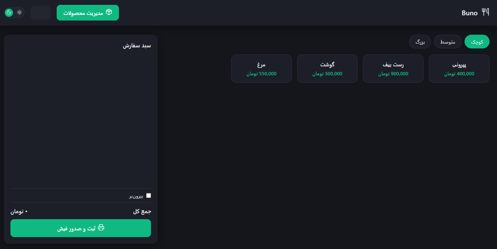
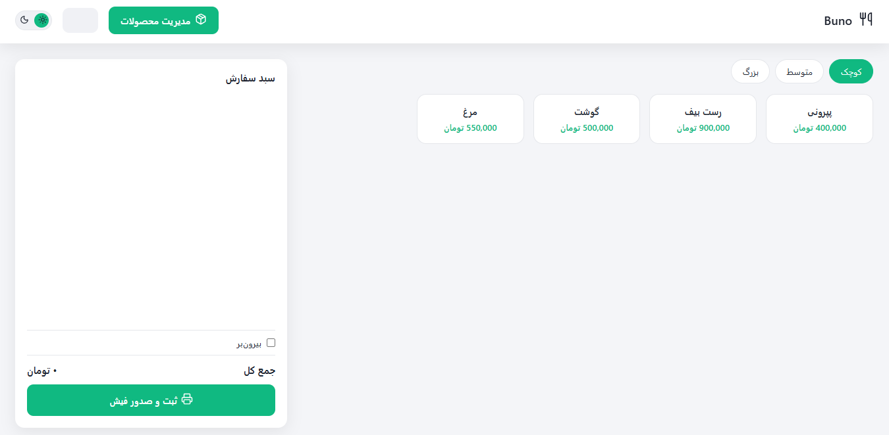

<div align="center">

# 🍽️ Buno

### A Persian-language restaurant POS for Windows, built with Electron


<br/><br/>

Take orders, print customer receipts and kitchen tickets, and keep a daily log, all from one fast right-to-left interface.

</div>

---

## 📸 Screenshots

<div align="center">

| Dark mode | Light mode |
|:---:|:---:|
|  |  |

</div>

---

## ✨ Features

- 🛒 **Fast sales screen:** category tabs, product cards, and a live cart with quantity controls and a takeaway option
- 🗂️ **Product and category management:** popup editor with inline editing
- 🖨️ **Dual receipt printing:** a customer receipt and a kitchen ticket, sent to a thermal printer over ESC/POS
- 🍕 **Receipt templates:** a classic layout and a creative pizza-themed layout, switchable in settings
- 🧾 **Daily order log:** resets automatically by Jalali date, with delete support
- ⚙️ **Settings:** restaurant info, logo upload, tax percentage and footer message
- 🌗 **Dark and light mode:** your choice is remembered between sessions
- 🌐 **Persian first:** right-to-left layout, Jalali (Shamsi) calendar, and the Vazirmatn font
- 🚀 **Splash screen** and a packaged **Windows installer**

---

## 🧱 Tech Stack

| Part | Technology |
|---|---|
| Desktop shell | Electron |
| UI | HTML, CSS, vanilla JavaScript |
| Calendar | jalali-moment |
| Font | Vazirmatn |
| Printing | node-thermal-printer (ESC/POS), electron-pos-printer, pdf-to-printer |
| Icons | Lucide (lucide, lucide-static) |
| Packaging | electron-builder (NSIS installer) |

---

## 🚀 Getting Started

**Requirements:** [Node.js](https://nodejs.org) (LTS) and Windows.

```bash
# 1. Clone the repository
git clone https://github.com/khodemaki/Buno.git
cd Buno

# 2. Install dependencies
npm install

# 3. Run the app
npm start
```

### Build the Windows installer

```bash
npm run dist
```

electron-builder creates an NSIS installer in the `dist/` folder, named `RestaurantPOS-Setup-<version>.exe`. The installer lets you pick the install folder and creates desktop and Start Menu shortcuts.

> The build needs the `build/` folder (installer icon and sidebar artwork) to be present.

---

## 📁 Project Structure

```text
Buno/
├── main.js               # Electron main process
├── preload.js            # Secure bridge for the main window
├── index.html            # Main POS window
├── renderer.js           # POS interface logic
├── style.css             # Styles and themes
├── icons.js              # Icon set
├── receipt.html          # Receipt window
├── receipt-preload.js
├── receipt-renderer.js
├── splash.html           # Splash screen
├── splash-preload.js
├── assets/               # App images and artwork
├── fonts/                # Fonts
├── build/                # Installer icon and sidebar artwork
└── package.json          # Scripts and electron-builder config
```

---

## 🗺️ Roadmap

- [x] Sales screen with cart
- [x] Customer and kitchen receipt printing
- [x] Daily order log
- [x] Windows installer
- [ ] Improve print-width handling across different printers
- [ ] Sales reports

---

## 📫 Contact

Built by **khodemaki**.

[](https://t.me/khodemaki)
[](mailto:khodemaki@gmail.com)
